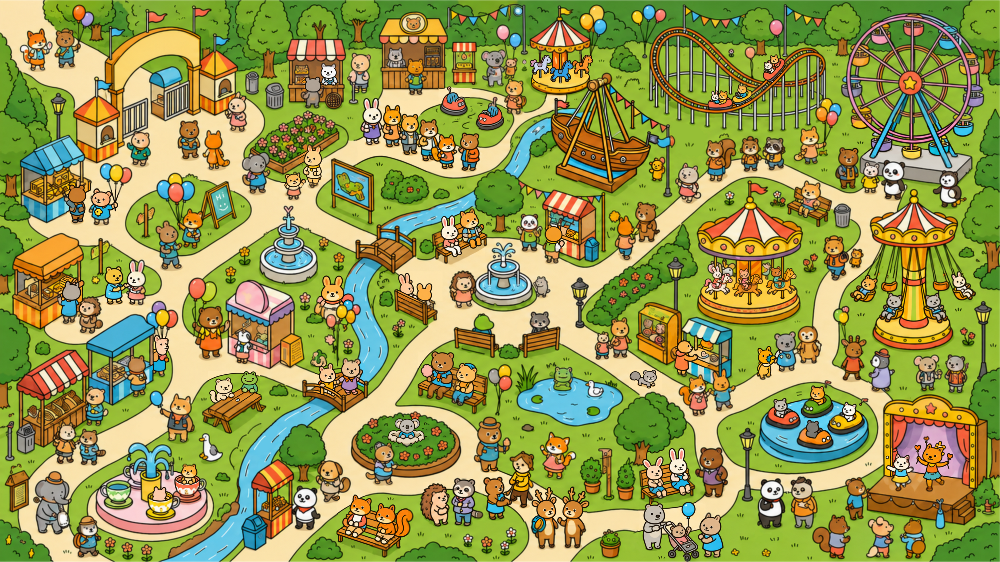

# Draw & Seek

거대한 공용 캔버스에 그림을 그려 숨기고, 다른 사람이 숨긴 그림을 찾는 웹 숨은그림찾기 게임입니다.
기획부터 개발, 배포, 운영까지 혼자 진행했습니다.

서비스: https://drawandseek.com



## 게임 방식

1. 캔버스의 빈 자리를 골라 그림을 그려 숨깁니다.
2. 다른 사람은 캔버스를 돌아다니며 숨은 그림을 찾아 클릭합니다.
3. 먼저 찾은 한 사람만 인정되고 찾힌 그림은 캔버스에서 사라집니다.

## 구조

- 캔버스는 512px 타일 피라미드로 잘라 Supabase Storage에 둡니다. 클라이언트는 현재 배율에 맞는 레벨의 타일만 받습니다.
- 그림을 숨기거나 찾으면 겹치는 타일만 Supabase Edge Functions의 ImageMagick WASM으로 다시 합성합니다.
- 타일 URL에 캔버스 버전을 붙여 immutable로 캐시합니다. CDN 엣지에서 서빙되고 스토리지 왕복은 타일당 최초 1회입니다.
- 그림 좌표는 서버만 갖고 판정도 서버에서 합니다. 기기별로 분당 판정 횟수와 시간당 업로드 수를 제한해 무차별 클릭 스캔을 막습니다.

## 설계에서 결정한 것

**판정은 즉시, 재합성은 나중에.** 그림을 찾으면 겹치는 타일을 다시 합성하는데 스토리지 왕복이 많아 수 초가 걸렸습니다. 판정 응답이 그만큼 늦어져 클릭이 안 눌린 것처럼 느껴졌습니다. 판정은 `found_at` 갱신으로 바로 확정해 응답하고 재합성은 응답 뒤 백그라운드로 미룹니다. 캔버스 버전은 재합성이 끝난 뒤에만 올려서 클라이언트가 새 버전을 보면 새 타일이 준비돼 있도록 순서를 보장합니다.

**동시 클릭은 한 명만.** 같은 그림을 두 사람이 거의 동시에 클릭하면 둘 다 찾은 것으로 처리될 수 있었습니다. `found_at IS NULL` 조건을 붙인 업데이트로 한 명만 성공합니다. 갱신된 행이 없으면 다른 사람이 먼저 찾은 것으로 응답합니다.

**신고와 관리.** 신고는 (그림, 기기) 복합 키로 중복을 DB에서 막습니다. 관리자 콘솔은 환경변수의 비밀 슬러그로만 rewrite되도록 미들웨어를 두어 저장소에 관리자 경로가 남지 않습니다.

## 기술

TypeScript, Next.js 15, React 19, Cloudflare Workers (OpenNext), Supabase (PostgreSQL, Storage, Edge Functions), ImageMagick WASM. 로컬 도안 생성에는 sharp를 사용합니다.

| 경로 | 역할 |
|---|---|
| `app/api/` | 캔버스 메타, 타일 서빙, 그림 업로드, 판정, 히스토리, 신고, 관리자 콘솔 API |
| `app/admin-console/` | 관리자 콘솔 화면 |
| `app/(default)/` | 한국어 게임·히스토리 및 관리자 페이지 라우트 |
| `app/(international)/[locale]/` | 언어별 게임·히스토리 정적 페이지 |
| `components/` | 캔버스 뷰포트, 타일 레이어, 그리기 패널, 배치 오버레이, 랭킹 패널 |
| `lib/` | 타일 좌표 계산, 타일 합성, 스토리지, 배치, 신고, 관리자 인증 |
| `scripts/` | 도안 생성과 타일 시드, 스토리지 동기화, DB 점검 |
| `supabase/functions/image-service/` | 무료 Edge Functions용 이미지 측정·저장·썸네일·타일 합성 |
| `supabase/migrations/` | 스키마 (canvas, drawings, find_attempts, reports) |
| `middleware.ts` | 관리자 콘솔 비밀 슬러그 rewrite |

## 로컬 실행

```bash
cp .env.example .env.local   # Supabase 키와 관리자 슬러그를 채웁니다
npm install
npm run db:start             # 로컬 Supabase (Docker)
npm run db:reset             # 마이그레이션 적용, DB 점검, 스토리지 동기화
npm run functions:serve # 별도 터미널에서 이미지 함수 실행
npm run dev
```

기본 도안 타일은 아래 순서로 만듭니다.

| 스크립트 | 하는 일 |
|---|---|
| `npm run gen-regions` | Pollinations API로 도안 구역 이미지를 격자로 생성 |
| `npm run stitch` | 구역 이미지를 이어 붙여 초대형 도안 생성 |
| `npm run seed` | 도안을 타일 피라미드로 잘라 `data/tiles/`에 저장 |
| `npm run sync-storage` | `data/`를 Supabase Storage의 canvas 버킷으로 업로드 |
| `npm run check-db` | Supabase 연결과 스키마 검증, canvas 행 시드 |

배포 및 Workers 미리보기 절차는 [DEPLOY.md](DEPLOY.md)를 참고하세요. Cloudflare Workers Free와 Supabase Free만 사용합니다.

## 언어별 검색 노출

한국어는 `/`, 영어는 `/en`이며 일본어(`/ja`), 중국어(`/zh`), 스페인어(`/es`),
프랑스어(`/fr`), 독일어(`/de`)도 지원합니다. 각 언어의 `/history` 주소에서 기록을
확인할 수 있습니다. 상단 지구본 메뉴로 언어를 바꾸며, 브라우저 언어와 관계없이 URL의
언어로 첫 HTML과 게임 UI를 제공합니다.

언어별 제목·설명·공유 메타데이터와 canonical, hreflang, 구조화 데이터를 함께 생성합니다.
`/sitemap.xml`에는 14개 공개 페이지와 언어별 연결이 포함됩니다.
소개 문구는 검색엔진과 사용자에게 동일하게 제공되며 게임 도움말에서 볼 수 있습니다.

개발 서버 또는 `npm run build` 후 실행한 서버를 대상으로 다음을 확인합니다.

```bash
npm run seo:check -- http://localhost:3000
```

배포 후 Search Console에서 `https://drawandseek.com/sitemap.xml`을 제출하고 `/en`의
색인 상태를 확인합니다. 국가·검색어별 노출수, 클릭수, CTR을 기준으로 효과를 비교합니다.

## 환경변수

| 이름 | 용도 |
|---|---|
| `SUPABASE_URL` | Supabase 프로젝트 URL |
| `SUPABASE_SERVICE_ROLE_KEY` | 서버에서 쓰는 서비스 롤 키 |
| `ADMIN_SLUG` | 관리자 콘솔 비밀 경로 |
| `ADMIN_PASSWORD` | 관리자 콘솔 비밀번호 |
| `NEXT_PUBLIC_GA_ID` | GA4 측정 ID (선택) |
